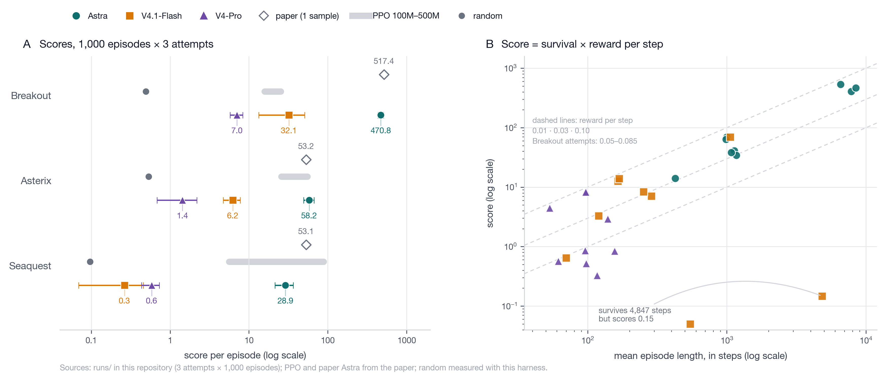
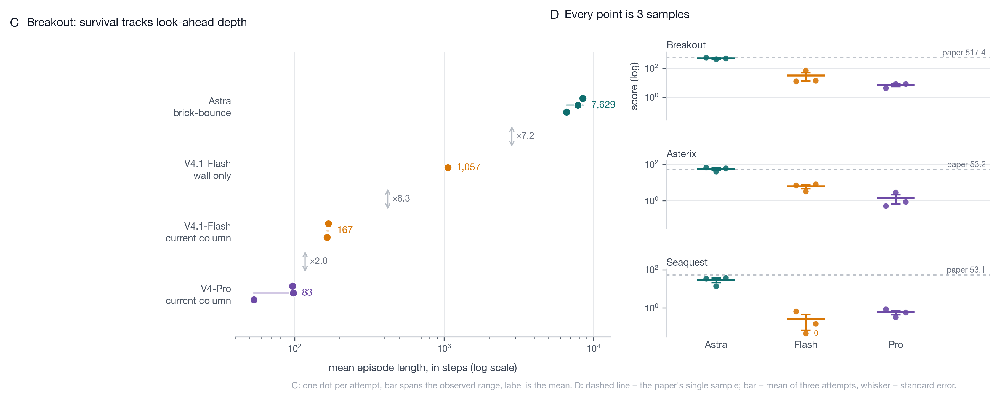

# Reproducing Experiment 5 of *Sparks of Weight-Space Programming*

**Can a language model write the weights of a neural network — from zero, in one
shot, with no tools — that then plays an Atari game?**

This repository reproduces Experiment 5 of
*Sparks of Weight-Space Programming* (Takehi, Teoh, Zhang & Khattab, 2026-11-02)
on three MinAtar games, **Breakout**, **Seaquest** and **Asterix**, under the
paper's protocol. It contains the harness, the verbatim prompts, every raw
model reply, the parsed weight files, the scores, and a cross-model comparison
against two DeepSeek models.


---

## Headline results

Mean score over 1,000 episodes, 3 independent one-shot attempts per game
(± standard error of the mean over attempts).

| game | random¹ | PPO 100M | PPO 500M | **Astra (paper)** | **Astra (this repo)** | DeepSeek V4.1-Flash | DeepSeek V4-Pro |
|---|---|---|---|---|---|---|---|
| Breakout | 0.49 | 15.8 | 25.3 | **517.4** | **470.8 ± 37.8** | 32.1 ± 18.8 | 7.0 ± 1.3 |
| Asterix  | 0.53 | 25.8 | 55.2 | **53.2**  | **58.2 ± 8.7**   | 6.2 ± 1.5   | 1.4 ± 0.7 |
| Seaquest | 0.10 | 5.6  | 88.9 | **53.1**  | **28.9 ± 7.5**   | 0.3 ± 0.2   | 0.6 ± 0.1 |

¹ Random is measured with this harness (1,000 episodes, `logs/random_baseline.json`);
the PPO baselines are quoted from the paper.

Per-attempt detail: [Astra](docs/results-astra.md) ·
[V4.1-Flash](docs/results-flash.md) · [V4-Pro](docs/results-v4pro.md). Full
write-up: **[docs/REPORT.md](docs/REPORT.md)**.

The model under test is `openai/gpt-6-astra` (served through the ofox relay,
`reasoning_effort=xhigh`). The DeepSeek arms use the same prompts and the same
evaluator; only the model changes.



*Left: scores per game on a log axis, with the paper's PPO range, the random
policy measured here and the paper's single Astra sample. Right: every attempt
plotted as score against episode length — on Breakout all nine attempts sit in
the same 0.05–0.085 band of reward per step, so the horizontal spread, survival,
is what separates the models. Generated by [`figures/make_figures.py`](figures/make_figures.py).*



*Left: Breakout survival by how far ahead the written circuit looks (≈×7 per
extra layer). Right: the three attempts behind every point against the paper's
single sample. Details in [`figures/README.md`](figures/README.md).*

---

## What is verified, and how strongly

1. **Measurement is bit-exact.** Replaying the three released Astra replies
   through our `edits` DSL parser reproduces the released
   `ref/exp5/networks/*.npz` weight files with `max abs diff = 0`. Our evaluator
   then scores those released weights at 502.9 (Breakout), 53.4 (Asterix) and
   54.0 (Seaquest) — within 1.9 SE of the published 517.4 / 53.2 / 53.1. An
   independent scorer ([PR #1](https://github.com/RikiyaT/lm_understand-logs/pull/1))
   reports 502.8 / 52.6 / 52.4 on the same artifacts.
2. **Astra's capability reproduces on two of three games.** Breakout −9 %,
   Asterix +9 % relative to the paper, both inside the between-attempt spread.
3. **Seaquest is 46 % below the paper** (28.9 vs 53.1). All three of our
   attempts (14–38) sit below the published number; we treat this as an open
   discrepancy rather than a refutation — see
   [Limitations](docs/REPORT.md#5-limitations).
4. **The DeepSeek gap is structural, not a token-budget gap.** Flash spends
   3.2× more tokens than Astra and still scores 9–110× lower. The per-step
   reward rate is nearly identical across models on Breakout (0.05–0.085);
   the entire gap is in how long the agent survives.

---

## Anatomy of the gap: score = survival × per-step efficiency

On Breakout every model earns about the same reward per step, so the score is
essentially a measure of *look-ahead depth in the hand-written circuit*:

| strategy (as written into the weights) | mean episode length | reward / step | score |
|---|---|---|---|
| Astra: predicts the landing column including **brick bounces** | 6,588–8,460 | 0.05–0.08 | 406–537 |
| Flash, best attempt: projects the ball to the **wall only** | 1,057 | 0.066 | 69.8 |
| Flash, other attempts: tracks the **current ball column** | 165–168 | 0.077–0.083 | 12.6–13.9 |
| V4-Pro: tracks the current ball column | 53–98 | 0.083–0.085 | 4.5–8.4 |

Each extra layer of prediction multiplies survival by roughly 6–8×. Astra's
answer explicitly handles the up-phase brick rebound and corrects the estimate
as the ball rises; the best DeepSeek attempt only did the wall projection.

A second difference is *how* correctness is obtained. Astra encodes logic in
the saturated tails of `tanh` (hard ±1000 comparisons, −415 gates, ±90 action
margins) — correctness by **structure**. The DeepSeek runs mostly assemble
expressions in the quasi-linear region and then verify them **arithmetically in
prose** (V4.1-Flash burns 70k–116k reasoning tokens per attempt, against
16k–30k for Astra), which is where the sign and scaling errors come from. One
V4-Pro Asterix attempt, for example, adds a constant −40 penalty to the up/down
actions and therefore disables vertical movement entirely.

---

## The experiment

| item | setting |
|---|---|
| observation | 6 channels × 10×10 = 600 inputs (player, danger, reward, projectile, trail, gauge) |
| policy | MLP 600 → 32 → 32 → 6, `tanh`, 20,486 parameters, **initialised to all zeros** |
| actions | 6 logits, softmax sampling, sticky actions p = 0.1, ≤ 10,000 steps per episode |
| score | mean return over 1,000 episodes (seeds 0–999) |
| prompt | the released prompt, verbatim (9,973 / 18,266 / 10,930 chars) |
| model access | one turn, **no tools, no execution, no revision**; the model only emits a fenced `edits` block |
| attempts | 3 independent samples per game (the paper reports 1) |

The model never sees a rollout. It emits weight assignments in a small DSL
(strided slice assignment, 2-D blocks, scalar fills, `*=`, `+=`, `-=`); the
last `edits` block in the reply is parsed, the weights are materialised, and
the network is scored.

```text
  prompt + zero-weight spec
            │
            ▼
  model ── one turn, no tools, no rollout ──▶ reply containing a fenced `edits` block
                                                        │
                                                        ▼
                                                  DSL parser
                                                        │
                                                        ▼
                                        weights.npz  (600 → 32 → 32 → 6)
                                                        │
                                                        ▼
                                      MinAtar evaluator  (1,000 episodes)
                                                        │
                                                        ▼
                                                     score
```

---

## Quickstart

```bash
git clone https://github.com/yzw-22/astra-weight-space-repro && cd astra-weight-space-repro
conda create -n astra python=3.10 -y && conda activate astra
pip install -r code/requirements.txt
export MPLCONFIGDIR=$PWD/.mplcache

# 1) measurement gate — no API key needed, must print ALL CHECKS PASS
python code/check_reference.py --episodes 100

# 2) one live attempt (needs an OpenAI-compatible endpoint)
export DEEPSEEK_API_KEY=...        # or OFOX_API_KEY=... for Astra
python code/run_experiment.py --game breakout --attempts 1 --episodes 1000 --runs-root runs/local

# 3) score a stored weight file
python code/eval_minatar.py --weights runs/astra/breakout/attempt1/weights.npz \
    --game breakout --episodes 1000

# 4) rebuild a results table
python code/report.py --runs-root runs/astra --out docs/results-astra.md
```

`code/run_experiment.py` writes `config.json`, `prompt.txt`, `reply.md`,
`usage.json`, `parse.json`, `weights.npz` and `eval.json` per attempt, so every
number below can be traced back to a raw model reply.

---

## Repository layout

| path | contents |
|---|---|
| `code/` | harness: MinAtar wrapper, `edits` DSL parser, LLM client, runner, evaluator, table builder |
| `code/prompts/` | the three prompts, verbatim from the released logs |
| `runs/astra/` | 9 Astra attempts: raw reply, parsed weights, usage, cost, score |
| `runs/flash/` | 9 DeepSeek V4.1-Flash attempts |
| `runs/v4pro/` | 9 DeepSeek V4-Pro attempts |
| `logs/` | console logs for most arm × game pairs (named `astra_*`, `flash_*`, `v4pro_*`), plus the reference-replay scores |
| `ref/exp5/` | the **authors' released** artifacts (prompts, replies, weights, their harness logs and `src/`), used by `check_reference.py` |
| `docs/` | [full report](docs/REPORT.md) and per-arm result tables |
| `figures/` | two result figures (PNG + SVG) and the script that renders them |

---

## Cost

| arm | tokens, 9 attempts | API cost |
|---|---|---|
| Astra | 269,210 | **$12.28** (≈ $0.022 per score point) |
| DeepSeek V4.1-Flash | 863,508 | provider pricing |
| DeepSeek V4-Pro | 529,427 | provider pricing |

Astra's figure is the relay's list price (input $10/M, output $50/M, cache read
$1/M, cache write $12.5/M) multiplied by the usage returned for each of the nine
scored calls; per-attempt artifacts in `runs/astra/*/attempt*/usage.json` carry
the same numbers.

---

## Limitations

* **Endpoint.** Astra was served through a relay; the sampling temperature,
  `reasoning_effort=xhigh` and message framing match the authors' description,
  but the system prompt and context configuration may differ.
* **Sample size.** Three attempts per game. The paper reports a single sample,
  and between-attempt spread is large (Astra Breakout 406–537,
  Flash Breakout 12.6–69.8), so the published numbers should be read as *one
  draw*, not as a stable mean.
* **Baselines.** PPO numbers are quoted from the paper, not retrained; the random
  baseline is measured here with the same protocol (`code/baseline_random.py`).
* **Evaluation seeds.** Ours differ from the paper's; the released-weight check
  still lands within 1.9 SE.
* **Cost accounting.** List price × the usage returned for each scored call;
  these are estimates, and a provider's own invoice may differ.
* **One truncated sample.** A V4-Pro Asterix sample hit the 65,536-token cap
  before emitting a weight block and was re-sampled at 131,072 tokens; it is not
  one of the 27 scored attempts.

---

## Attribution

* Paper and blog: *Sparks of Weight-Space Programming* (Takehi, Teoh, Zhang & Khattab), https://rikiyat.github.io/blog/weight-space-programming/
* Released artifacts (prompts, replies, weights) in `ref/exp5/` come from the
  authors' public repository, https://github.com/RikiyaT/lm_understand-logs, and
  are included only to make the measurement check reproducible; all rights
  remain with them.
* MinAtar: Young & Tian, *MinAtar: An Atari-Inspired Testbed*.

## License

MIT for the code in `code/` and the data in `runs/` and `docs/`. The
`ref/exp5/` directory is redistributed from the original authors' release and is
**not** covered by that license.
