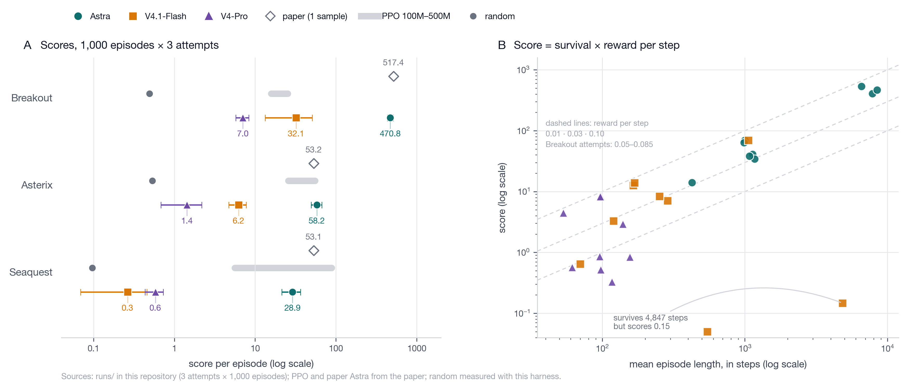
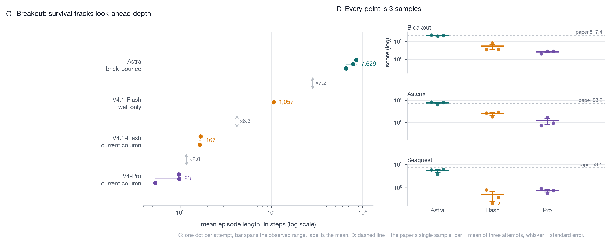

# Reproducing Experiment 5 of *Sparks of Weight-Space Programming*

**A weight-space programming audit: MinAtar Breakout, Seaquest and Asterix,
three models, 27 one-shot attempts.**

*Report date: 2026-11-03 · Environment: Python 3.10, MinAtar 1.0.15, gym 0.26.2,
numpy 2.2 · Raw artifacts: [`runs/`](../runs) · Tables:
[Astra](results-astra.md), [V4.1-Flash](results-flash.md),
[V4-Pro](results-v4pro.md)*

---

## Abstract

We reproduce Experiment 5 of *Sparks of Weight-Space Programming*: a language
model writes all 20,486 weights of a 600→32→32→6 `tanh` policy for a MinAtar
game from a zero initialisation, in a single turn, with no tools and no access
to a simulator. We run the paper's three games and three models — GPT-6 Astra
(the paper's model), DeepSeek V4.1-Flash and DeepSeek V4-Pro — with three
independent attempts per game, and score each weight file over 1,000 episodes.

The measurement side reproduces **bit-exactly**: replaying the released Astra
replies through our DSL yields weight files identical to the released ones
(`max |diff| = 0`), and our evaluator scores those released weights within
1.9 SE of the published numbers. Astra's capability reproduces on Breakout
(−9 %) and Asterix (+9 %); Seaquest lands 46 % below the paper, which we report
as an unresolved discrepancy. The DeepSeek arms are 9–110× worse despite
spending 2–3× more tokens, and the gap decomposes almost entirely into
*survival time*, i.e. into how deep a prediction the written circuit performs —
not into token budget or reasoning effort.

---

## 1. What is being claimed

The paper's Experiment 5 asks whether a model can *program in weight space*: emit
the parameters of a policy network directly, as text, without gradient descent
and without ever running the environment. The claim is not that the model is a
good RL algorithm, but that it can compile a strategy into a fixed circuit whose
behaviour is predictable from its structure alone.

Three properties make this a clean capability probe:

* **No execution feedback.** The model cannot test its answer, so errors are
  never corrected; the circuit must be right by construction.
* **No search.** One sample, one turn. Sampling variance is therefore large and
  must be reported.
* **No representation shortcut.** The model must choose its own features
  (which of the 600 inputs to use, and how to combine them) inside a fixed
  20,486-parameter budget.

## 2. Protocol

| item | setting |
|---|---|
| observation | 6 channels × 10×10 = 600 inputs: player, danger, reward, projectile, trail, gauge |
| policy | MLP 600 → 32 → 32 → 6, `tanh`, 20,486 parameters, initialised to zeros |
| action selection | 6 logits → softmax sampling, sticky actions p = 0.1, episode cap 10,000 steps |
| score | mean return over 1,000 episodes (seeds 0–999), reported with SE over attempts |
| prompt | the released prompt, verbatim (9,973 / 18,266 / 10,930 characters) |
| answer format | a single fenced `edits` block of weight assignments; the last block wins |
| DSL | strided slice assignment, 2-D blocks, scalar fill, `*=`, `+=`, `-=`; bad statements are skipped and counted |
| models | `openai/gpt-6-astra` (`reasoning_effort=xhigh`, temp 1.0, 40,960 max tokens) · `deepseek-flash` (`reasoning_effort=max`, 131,072 max tokens) · `deepseek-v4-pro` (same) |
| attempts | 3 independent samples per game per model (the paper reports 1) |

The parser is deliberately forgiving — a malformed statement is skipped, not
fatal — so a model that makes a local syntax error can still be scored. We
record the applied/emitted statement ratio for exactly this reason.

## 3. Results

### 3.1 Headline

| game | random¹ | PPO 100M | PPO 500M | Astra (paper) | Astra (this repo) | V4.1-Flash | V4-Pro |
|---|---|---|---|---|---|---|---|
| Breakout | 0.49 | 15.8 | 25.3 | 517.4 | **470.8 ± 37.8** | 32.1 ± 18.8 | 7.0 ± 1.3 |
| Asterix | 0.53 | 25.8 | 55.2 | 53.2 | **58.2 ± 8.7** | 6.2 ± 1.5 | 1.4 ± 0.7 |
| Seaquest | 0.10 | 5.6 | 88.9 | 53.1 | **28.9 ± 7.5** | 0.3 ± 0.2 | 0.6 ± 0.1 |



Values are mean ± SE over the three attempts. ¹ Random is measured with this
harness (1,000 episodes, [`logs/random_baseline.json`](../logs/random_baseline.json));
the PPO baselines are quoted from the paper.

### 3.2 Per attempt

| model | game | attempt scores | mean | statements | nonzero weights |
|---|---|---|---|---|---|
| Astra | Breakout | 537.3 / 406.4 / 468.8 | 470.8 ± 37.8 | 244 / 159 / 190 | 4,983 / 2,421 / 1,866 |
| Astra | Asterix | 69.6 / 41.0 / 64.0 | 58.2 ± 8.7 | 110 / 132 / 170 | 1,716 / 942 / 794 |
| Astra | Seaquest | 34.4 / 14.1 / 38.2 | 28.9 ± 7.5 | 135 / 181 / 177 | 548 / 1,269 / 1,747 |
| V4.1-Flash | Breakout | 12.6 / 69.8 / 13.9 | 32.1 ± 18.8 | 154 / 108 / 221 | 775 / 933 / 1,559 |
| V4.1-Flash | Asterix | 7.1 / 3.3 / 8.4 | 6.2 ± 1.5 | 142 / 217 / 267 | 540 / 612 / 876 |
| V4.1-Flash | Seaquest | 0.6 / 0.0 / 0.1 | 0.3 ± 0.2 | 382 / 160 / 309 | 3,429 / 1,355 / 2,963 |
| V4-Pro | Breakout | 4.5 / 8.4 / 8.3 | 7.0 ± 1.3 | 22 / 46 / 17 | 184 / 311 / 107 |
| V4-Pro | Asterix | 0.5 / 2.9 / 0.9 | 1.4 ± 0.7 | 153 / 160 / 129 | 1,189 / 618 / 628 |
| V4-Pro | Seaquest | 0.8 / 0.3 / 0.6 | 0.6 ± 0.2 | 395 / 277 / 200 | 1,969 / 2,356 / 1,662 |

Full per-attempt tables, including reasoning-token counts, USD cost, mean
episode length and the action mix over 500 steps, are in
[results-astra.md](results-astra.md), [results-flash.md](results-flash.md) and
[results-v4pro.md](results-v4pro.md).

### 3.3 Validating the measurement

Before trusting any model comparison we checked that the harness reproduces the
released artifacts (`code/check_reference.py`; gate output in
[`logs/reference_check.json`](../logs/reference_check.json), 100 episodes per game):

| check | result |
|---|---|
| prompt files byte-identical to the released logs (9,973 / 18,266 / 10,930 chars) | pass, all three |
| released reply → DSL → weights vs released `ref/exp5/networks/*.npz` | byte-identical, `max abs diff = 0`, all three |
| our evaluator on released weights, 1,000 episodes ([`logs/ref_*.json`](../logs)) | 502.9 ± 7.7 (Breakout) / 53.4 ± 1.0 (Asterix) / 54.0 ± 1.4 (Seaquest) |
| published values | 517.4 / 53.2 / 53.1 — all within 1.9 SE |
| independent scorer ([PR #1](https://github.com/RikiyaT/lm_understand-logs/pull/1)) on the same weights | 502.8 / 52.6 / 52.4 |

So the environment wrapper, the sticky-action and sampling protocol, the DSL
semantics and the scoring pipeline are all pinned down. On Breakout and Asterix
the differences below are therefore attributable to the models, not the
measurement; the Seaquest gap (§4.1) may still carry a measurement-side
component.

## 4. Analysis

### 4.1 How well does Astra reproduce?

* **Breakout: −9 %** (470.8 vs 517.4). Attempts span 406–537; the published
  value sits near the top of our spread. Consistent with single-sample variance.
* **Asterix: +9 %** (58.2 vs 53.2). Attempts span 41–70, published value in the
  middle. Good reproduction.
* **Seaquest: −46 %** (28.9 vs 53.1). All three attempts (14–38) fall below the
  published number. Candidate explanations: sampling variance with a long right
  tail, subtle differences in the relay endpoint (version, `reasoning_effort`
  mapping), or a different evaluation seed set. With n = 3 we cannot separate
  these; the honest statement is that Seaquest is *reproduced in kind, not in
  magnitude*.

### 4.2 Where the score comes from

On Breakout the per-step reward rate is nearly model-independent, so the score
is essentially a survival-time measurement:

| strategy written into the weights | mean episode length | reward / step | score |
|---|---|---|---|
| Astra: landing column **including brick bounces** | 6,588–8,460 | 0.052–0.082 | 406–537 |
| Flash (best): landing column with **wall bounce only** | 1,057 | 0.066 | 69.8 |
| Flash (others): **current ball column** tracking | 165–168 | 0.077–0.083 | 12.6–13.9 |
| V4-Pro: current ball column tracking | 53–98 | 0.083–0.085 | 4.5–8.4 |



Each additional layer of prediction multiplies survival by roughly 6–8×:
current column → wall projection → brick-bounce-aware projection. Astra's reply
explicitly describes predicting the earliest brick rebound during the up-phase
and correcting as the ball rises; the best DeepSeek reply stops at the wall.

The point is not that Astra "thinks longer". It is that Astra chooses a
*different computation*: a simulator of the ball's future position, expressed as
weights. DeepSeek writes a controller for the ball's present position.

### 4.3 Structure versus arithmetic

Astra's circuits are built from saturated `tanh` units: hard ±1000 comparisons,
−415 gate biases, ±90 action margins. Logic is encoded in **saturation regions**,
where a small weight error does not change the answer. Astra also spends far
fewer tokens on reasoning (15.9k–29.8k per attempt).

Statement count alone is not the differentiator: Astra emits 110–244 statements,
V4.1-Flash 108–382, and V4-Pro as few as 17 on Breakout — yet Pro's 17-statement
Breakout circuit survives only ~100 steps while Astra's 159–244-statement
Breakout circuits survive 6,600–8,500. What separates them is *what the statements
encode*, not how many there are.

The DeepSeek traces work in the **quasi-linear region** and then verify
themselves arithmetically in prose (V4.1-Flash: 70k–116k reasoning tokens per
attempt; V4-Pro: 18k–92k). That
verification is local: it checks each term but not the global behaviour of the
circuit. Representative failures:

* **V4-Pro, Asterix, attempt 1.** Eight "same-row escape" units are given a
  uniform `+5`, but they sit at `−1` when inactive, which adds a constant −40 to
  both up and down actions. Vertical movement is dead; the agent drifts
  horizontally and dies in ~97 steps (score 0.5).
* **V4.1-Flash, Seaquest, attempt 2.** 99.2 % of actions are "up": the agent
  survives 546 steps without ever scoring, because survival and reward were not
  separated in the circuit.
* **No-op collapse.** V4.1-Flash Asterix emits 72–91 % no-ops; Astra's Asterix
  answers do the same (88–99 %) but pair it with a working fire/vertical policy,
  scoring 41–70 rather than 3–8.
* **Local syntax errors.** Astra's Asterix attempt 2 contains vector-valued
  `-=` statements that the DSL rejects. 12 of its 132 statements are dropped;
  the rest still score 41.0 — a reminder that a forgiving parser can mask local
  bugs.

The pattern is consistent: when correctness is enforced by structure, residual
errors are harmless; when correctness is enforced by arithmetic performed in
text, errors in sign or scale are undetectable without running the policy.

### 4.4 Cost and token efficiency

| metric | Astra | V4.1-Flash | V4-Pro |
|---|---|---|---|
| output tokens per attempt | 20.7k–33.2k | 73.2k–118.7k | 19.0k–95.5k |
| total tokens, 9 attempts | **269,210** | 863,508 | 529,427 |
| API cost, 9 attempts | **$12.28** (list price × returned usage) | provider pricing | provider pricing |
| cost per score point (3-game mean total) | **≈ $0.022** | — | — |

Astra uses about one third of Flash's tokens to reach a 14.5× higher summed
score. Token budget is therefore not the binding constraint; the binding
constraint is whether the model can *simulate and compile*, and check the
result without executing it.

### 4.5 Single-sample reporting

Between-attempt spread is large: Astra Breakout 406–537, Flash Breakout
12.6–69.8. A single reported number is a draw from that distribution. The
paper's 517.4 should be read as one sample of Astra, not as a stable capability
level — and small differences between papers and reproductions (our −9 % on
Breakout) are well inside the noise.

## 5. Limitations

1. **Endpoint.** Astra was served through a third-party relay
   (`reasoning_effort=xhigh`, temperature 1.0, 40,960 max tokens). The authors'
   harness also used xhigh, but system prompt, context layout and caching policy
   are not observable, and the served model version may differ.
2. **Sample size.** Three attempts per game; Seaquest in particular needs more
   samples before the gap can be attributed.
3. **Baselines.** PPO numbers are quoted from the paper, not retrained; the
   random baseline is measured here under the same protocol.
4. **Seeds.** Our evaluation seeds differ from the paper's; the released-weight
   control bounds this effect at ~1.9 SE.
5. **Cost.** Figures are list price × the usage returned for each scored call;
   they are estimates, and a provider's own invoice may differ.
6. **Prompt provenance.** Prompts are copied verbatim from the released logs, not
   from the paper text.
7. **One truncated sample.** A V4-Pro Asterix sample hit the 65,536-token
   completion cap before emitting a weight block and was re-sampled at 131,072
   tokens; the truncated sample is not one of the 27 scored attempts.

## 6. Conclusions

1. **The measurement reproduces exactly.** Three independent implementations
   (authors, an external contributor, this repository) agree on both the parsed
   weights and their scores.
2. **Astra's capability reproduces** on Breakout and Asterix within ±9 %; the
   Seaquest gap is open.
3. **The DeepSeek gap is structural.** It is not token budget: Flash spends more
   tokens and scores an order of magnitude lower. It is the difference between
   *simulating the environment in weights* and *tracking the current frame*,
   plus the difference between *structure-guaranteed* and
   *arithmetic-verified* correctness.
4. **Implication for training.** Weight-space programming is unlikely to be
   taught by weight-editing SFT. What these traces suggest is trainable is the
   loop: build a world model → compile it into a saturating circuit → verify the
   circuit globally without executing it. Reward should be attached to
   *structural* properties of the artifact (saturation margins, invariance to
   weight perturbation, consistency under simulated inputs), not to how much
   arithmetic the model performs.

---

## Appendix A — Artifacts

| path | contents |
|---|---|
| `code/core.py` | 6-channel MinAtar wrapper, MLP policy, 1,000-episode evaluator |
| `code/edits_dsl.py` | parser/applier for the `edits` block |
| `code/llm.py` | OpenAI-compatible client (DeepSeek / relay), cost accounting |
| `code/run_experiment.py` | prompt → reply → weights → score, one directory per attempt |
| `code/check_reference.py` | bit-exactness gate against the released artifacts |
| `code/report.py` | rebuilds the per-arm result tables |
| `runs/<arm>/<game>/attempt<k>/` | `config.json`, `prompt.txt`, `reply.md`, `usage.json`, `parse.json`, `weights.npz`, `eval.json` |
| `logs/` | console logs for most arm × game pairs (`astra_*`, `flash_*`, `v4pro_*`) and the reference-replay scores |
| `figures/` | the two figures in this report and `make_figures.py`, which renders them from `runs/` |
| `ref/exp5/` | the authors' released artifacts — prompts, replies, weights, their harness logs and `src/` ([source](https://github.com/RikiyaT/lm_understand-logs)) |

## Appendix B — Reproducing this report

```bash
export MPLCONFIGDIR=$PWD/.mplcache

# measurement gate (no API key)
python code/check_reference.py --episodes 100

# one live attempt
OFOX_API_KEY=... python code/run_experiment.py \
    --game breakout --attempts 1 --episodes 1000 --runs-root runs/local

# rebuild tables for the three stored arms
python code/report.py --runs-root runs/astra  --out docs/results-astra.md
python code/report.py --runs-root runs/flash  --out docs/results-flash.md
python code/report.py --runs-root runs/v4pro  --out docs/results-v4pro.md
```
